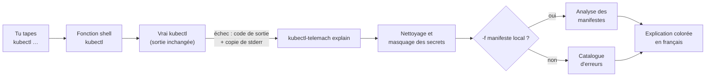

# TELEMACH PLUGIN KUBECTL

**TELEMACH** est un plugin pédagogique pour kubectl : quand une commande `kubectl` échoue, il
t'explique **en français** ce qui s'est passé, le concept Kubernetes en jeu, la cause probable
et comment corriger, avec une sortie largement colorée.

```text
$ kubectl get deploymnet -n demo
error: the server doesn't have a resource type "deploymnet"

✖ Le type de ressource « deploymnet » n'existe pas dans ce cluster.

📘 Concept — resource type
   Chaque objet Kubernetes a un type : pod, deployment, service, configmap…
   kubectl accepte le nom au singulier, au pluriel ou en abrégé (po, deploy,
   svc, cm), mais seulement pour les types que le cluster publie.

🔎 Cause probable
   C'est probablement une faute de frappe : le type connu le plus proche est
   « deployment ».

💡 Corrections
   1. Relancer la commande avec le type corrigé (le reste de ta commande est
      conservé).
      kubectl get deployment -n demo
   2. Lister tous les types de ressources connus du cluster, avec leurs noms
      courts.
      kubectl api-resources

── Message kubectl d'origine ───────────────────────────────────────────────────
error: the server doesn't have a resource type "deploymnet"

➜ Pour aller plus loin : kubectl telemach deepen
```

## Le projet

Quand on apprend Kubernetes, les erreurs arrivent vite, et elles sont écrites en anglais
technique : `pods "web" not found`, `cannot list resource "pods"`, `unknown field
"spec.replica"`, `ImagePullBackOff`… Le message dit **ce qui** a échoué, rarement **pourquoi**,
et encore moins **ce qu'il faut comprendre** pour ne plus refaire l'erreur.

TELEMACH transforme chaque erreur en petite leçon. Le nom vient de Télémaque, le fils
d'Ulysse, guidé par Mentor dans *l'Odyssée* : le plugin joue ce rôle de mentor, au moment
précis où tu en as besoin, dans ton propre terminal.

C'est le projet frère de [TELEMACH PLUGIN DOCKER](https://github.com/aboigues/telemach-plugin-docker),
pour les personnes qui débutent ou progressent avec Kubernetes : étudiants, développeurs qui
découvrent les clusters, formateurs qui veulent un compagnon pour leurs travaux pratiques.

## Le concept

### Une erreur = une leçon

Chaque explication suit toujours la même structure, pour que l'apprenant prenne l'habitude de
raisonner ainsi :

| Bloc | Rôle |
|------|------|
| ✖ **Résumé** | ce qui s'est passé, en une phrase |
| 📘 **Concept** | la notion Kubernetes en jeu (namespace, RBAC, selector, sonde…), définie simplement |
| 🔎 **Cause probable** | pourquoi c'est arrivé ici |
| 💡 **Corrections** | ce que tu peux faire, avec la commande prête à copier, qui garde ton contexte, ton namespace et tes autres options |
| ⚠ **Anti-pattern** | la « solution rapide » à éviter, et pourquoi (`cluster-admin`, `privileged`…) |
| ➜ **Pour aller plus loin** | `kubectl telemach deepen` : le concept détaillé, un exemple, un exercice |

Si la même erreur se répète dans les 10 minutes, TELEMACH n'affiche qu'un rappel court ;
`kubectl telemach last` réaffiche alors l'explication complète.

Le message kubectl d'origine reste affiché, atténué : on apprend aussi à lire soi-même les
erreurs de Kubernetes.

### Trois principes

- **Ne jamais inventer.** Une erreur inconnue est présentée comme telle, avec la version de
  kubectl et un lien vers la documentation officielle, mais sans cause supposée.
- **Ne jamais agir à ta place.** TELEMACH propose, tu décides : il ne modifie aucun fichier ni
  aucune ressource du cluster ; il se contente de lire.
- **Enseigner les bonnes pratiques.** Les exemples évitent root, `privileged` et les secrets
  écrits en clair ; une solution dangereuse est toujours signalée comme telle.

### Comment ça marche



1. **Capture.** `shell-init` définit une fonction `kubectl` dans ton shell. Elle lance le vrai
   `kubectl` sans toucher à son entrée ni à sa sortie standard, et garde une copie de la sortie
   d'erreur dans un fichier temporaire privé (`0600`), supprimé juste après, même après un
   Ctrl-C. `exec -it`, `attach`, `debug` et `port-forward` gardent leur terminal : seule leur
   sortie d'erreur est copiée, et un Ctrl-C n'est expliqué que s'il suit une erreur reconnue.
   Les autres commandes longues (`logs -f`, `get -w`, `edit`, `proxy`, `run -it`) ne sont pas
   redirigées : leur explication repose sur le code de sortie.
2. **Nettoyage.** Le texte capturé est traité comme non fiable : les séquences de contrôle du
   terminal sont neutralisées et les secrets (jetons, mots de passe, certificats, données d'un
   `Secret`, `user:motdepasse@`) sont masqués avant tout usage.
3. **Diagnostic.** Le **catalogue** (fichiers YAML en français, embarqués dans le binaire)
   reconnaît l'erreur grâce à des motifs relevés sur de vrais clusters.
4. **Manifestes.** Pour `kubectl apply -f`, `create -f`…, l'**analyseur** relit les fichiers
   locaux en lecture seule et pointe le fichier, le document, la ligne et le champ exacts, avec
   les règles des versions 1.35, 1.36 et 1.37 de Kubernetes embarquées.
5. **Rendu.** L'explication est affichée sur la sortie d'erreur, avec un code couleur par bloc
   et la coloration syntaxique des commandes et des extraits YAML.

### Erreurs reconnues

| Famille | Exemples |
|---------|----------|
| Ligne de commande | type de ressource mal orthographié, sous-commande ou option inconnue, option placée avant `telemach` |
| Connexion | kubeconfig absent, contexte inexistant ou non défini, serveur API injoignable, certificat inconnu |
| Namespace et ressources | namespace inexistant, ressource, conteneur ou fichier introuvable, conteneur inconnu pour `exec` ou `logs`, objet déjà existant ou modifié entre-temps, champ immuable refusé à l'`apply` |
| Transfert de port | port de ta machine déjà utilisé, pod arrêté, rien n'écoute sur le port du pod |
| Rollout | échéance de progression dépassée (`rollout status`) |
| Droits | identité non reconnue (`Unauthorized`), action refusée par RBAC (`Forbidden`) |
| Manifestes | tabulation, syntaxe YAML, champ inconnu ou mal placé, type de valeur, champ obligatoire, version d'API retirée, selector et labels incohérents, secret écrit en clair |
| Pods | `ImagePullBackOff`, nom d'image invalide, `CrashLoopBackOff`, `OOMKilled`, `Secret` ou `ConfigMap` absent, pod `Pending` (ressources, PVC, `nodeSelector`), sondes de disponibilité et de vie |
| Programme du conteneur | commande introuvable, code de sortie de l'application (`kubectl exec`), nom court d'un Service d'un autre namespace dans le journal |

### Vérifier des manifestes avant de les appliquer

`kubectl telemach check` vérifie des manifestes **sans contacter le cluster** :

```text
$ kubectl telemach check -f all.yaml
Règles Kubernetes 1.37
✖ Problème 1/1 — all.yaml:24:3 (document 3, Deployment/web)
   champ « spec.replica »
   Ce champ n'existe pas : tu voulais sans doute écrire « replicas ».

     22 │   name: web
     23 │ spec:
   ➤ 24 │   replica: 2
            ^
     25 │   selector:

   💡 Version corrigée
     24 │   replicas: 2
```

Les règles utilisées sont celles de la version mineure de ton client kubectl (1.35, 1.36 ou
1.37) ; avec une autre version, les règles 1.37 sont utilisées et la première ligne le dit.
Sans `-f`, aucun fichier n'est lu : TELEMACH t'explique le rôle de l'option (Kubernetes n'a pas
de fichier par défaut). `-R` parcourt les sous-dossiers.

Certains fichiers valides ne sont pas des objets de l'API : une ressource personnalisée (CRD),
dont seule la structure commune est vérifiée, un fichier de configuration de kubeadm, un
template ou un fichier de valeurs Helm. `check` les signale par une information (ℹ), qui ne
change pas son code de sortie.

**Vérifier un rendu avant de l'appliquer.** Avec `-f -`, `check` lit le manifeste sur l'entrée
standard, comme `kubectl apply -f -` : c'est la façon de vérifier ce que produisent Helm,
Kustomize ou un générateur kubectl. Les positions sont alors désignées par `<stdin>`, et pour
un rendu Helm chaque problème cite le template d'origine (`# Source:`).

```bash
helm template demo ./mon-chart | kubectl telemach check -f -
kubectl kustomize overlays/dev | kubectl telemach check -f -
kubectl create deployment web --image=nginxinc/nginx-unprivileged:1.30-alpine \
  --dry-run=client -o yaml | kubectl telemach check -f -
```

### Comprendre un pod qui ne démarre pas

Un `kubectl apply` peut réussir alors que le pod ne démarre jamais : l'erreur n'est alors que
dans son statut, ses événements ou son journal. Environ 10 secondes après un `apply`, `create`
ou `run` réussi, TELEMACH relit le seul statut des pods concernés et te prévient **à l'invite
suivante**, jamais au milieu d'une saisie :

```text
$ kubectl apply -n demo -f bad-image.yaml
pod/bad-image created
$
⚠ Le pod bad-image est en ImagePullBackOff : kubectl telemach diagnose pod/bad-image -n demo
```

`kubectl telemach diagnose` explique alors le pod, avec la fin de son journal :

```text
$ kubectl telemach diagnose pod/crash -n demo
✖ Le pod « crash » redémarre en boucle, son programme s'arrête avec le code 1.
   pod crash · namespace demo · image busybox:1.38 · état CrashLoopBackOff · 4 redémarrages
   (l'erreur vient du programme exécuté dans le conteneur, pas de Kubernetes)

📘 Concept — restart policy
   Quand le programme d'un conteneur s'arrête, Kubernetes le redémarre
   (restartPolicy: Always par défaut), en attendant de plus en plus longtemps
   entre deux essais : c'est la boucle CrashLoopBackOff.

🔎 Cause probable
   Kubernetes démarre bien le conteneur, mais le programme s'arrête aussitôt (4
   redémarrages). La cause est dans l'application ou sa configuration ; son
   journal indique « erreur : la variable DB_URL est obligatoire ».

💡 Corrections
   1. Lire le journal de l'exécution précédente du conteneur.
      kubectl logs crash -c app -n demo --previous
   …

📜 Fin du journal (conteneur app)
   erreur : la variable DB_URL est obligatoire
```

Sans argument, `diagnose` explique le pod en difficulté le plus récent du namespace, puis liste
les autres pods et objets en difficulté (au plus 10). Si une lecture t'est refusée par RBAC, le
diagnostic est marqué **partiel**, la lecture refusée est nommée et aucune cause n'est affirmée
sur ce qui n'a pas pu être lu.

### Ce qui réussit sans marcher

Un Service sans pod, un Ingress qu'aucun contrôleur ne prend, un rollout bloqué derrière une
ancienne version qui répond encore : kubectl dit « created » et rien ne marche.
`kubectl telemach diagnose <type>/<nom>` suit alors le chemin du trafic, maillon par maillon,
et s'arrête sur le premier qui casse :

```text
$ kubectl telemach diagnose service/web -n demo
✖ Le Service « web » ne désigne aucun pod, son selector ne correspond aux labels d'aucun pod.
   service web · namespace demo · ClusterIP · ports 80 → 8080

   ✔ type               ClusterIP
   ✖ selector           app=web : aucun pod
   · pods prêts         non vérifié
   ✔ endpoints          0 prêt(s)
   · ports              non vérifié

📘 Concept — label selector
   …
🔎 Cause probable
   Aucun pod du namespace demo ne porte les labels « app=web ». Les pods les
   plus proches portent « app=frontend » : le selector du Service ou les labels
   du modèle de pod ne sont sans doute pas écrits pareil.
```

| Type | Ce qui est vérifié |
|------|--------------------|
| `service/<nom>` | selector et pods désignés, pods prêts, EndpointSlices, `targetPort` (numéro ou nom) |
| `deployment/<nom>` | rollout (en cours, bloqué, en pause, et le pod en difficulté de la nouvelle version), tag d'image mutable, ConfigMap modifiée après le démarrage des pods |
| `ingress/<nom>` | classe effective et contrôleur, Services et ports visés, adresse attribuée |
| `pvc/<nom>` | classe de stockage, classe par défaut, mode de liaison, pod qui l'utilise |

Les états normaux sont présentés comme tels (PVC qui attend son premier pod, Service sans
selector). Après un `apply`, `create`, `run` ou `expose` réussi, la vérification différée
signale aussi, à l'invite suivante, les pièges durables des objets créés :

```text
⚠ Le Service web ne désigne aucun pod : kubectl telemach diagnose service/web -n demo
ℹ L'image nginx n'a pas de tag explicite : un nouvel apply ne la mettra pas à jour (kubectl telemach deepen)
```

## Installation

### Prérequis

| Outil | Version | Vérification |
|-------|---------|--------------|
| kubectl | 1.35, 1.36 ou 1.37 (les autres versions fonctionnent avec les règles 1.37) | `kubectl version --client` |
| Shell | bash ou zsh (Linux, macOS, WSL2) | `echo $SHELL` |

Go n'est nécessaire que pour compiler le plugin toi-même. Windows natif (PowerShell) n'est
pas pris en charge ; sous Windows, utilise WSL2.

### 1. Installer le plugin

kubectl découvre tout seul les programmes nommés `kubectl-<nom>` présents dans ton `PATH` :
`kubectl-telemach` devient ainsi la commande `kubectl telemach`. Choisis **une** des voies
ci-dessous ; les commandes indiquent toujours une version précise (ici `0.1.0`).

#### Depuis une Release (recommandé)

Chaque version est publiée sur la [page des Releases](https://github.com/aboigues/telemach-plugin-kubectl/releases),
avec un binaire par système et par processeur, un fichier de sommes de contrôle et une
signature. Télécharge-les **en ligne de commande** (sous macOS, un binaire téléchargé par un
navigateur peut être bloqué par le système).

Linux et WSL2 :

```bash
VERSION=0.1.0
ARCH=$(uname -m); case "$ARCH" in x86_64) ARCH=amd64 ;; aarch64|arm64) ARCH=arm64 ;; esac
FICHIER=kubectl-telemach_${VERSION}_linux_${ARCH}
curl -fsSLO "https://github.com/aboigues/telemach-plugin-kubectl/releases/download/v${VERSION}/${FICHIER}"
curl -fsSLO "https://github.com/aboigues/telemach-plugin-kubectl/releases/download/v${VERSION}/checksums.txt"
sha256sum --check --ignore-missing checksums.txt
mkdir -p ~/.local/bin
install -m 0755 "$FICHIER" ~/.local/bin/kubectl-telemach
kubectl telemach version
```

macOS : mêmes commandes avec `_darwin_` à la place de `_linux_`, et
`shasum -a 256 --check --ignore-missing checksums.txt` pour la vérification.

- `uname -m` donne ton processeur (`x86_64` ou `arm64`), traduit dans le nom du fichier.
- La ligne `sha256sum --check` compare le fichier téléchargé à sa somme publiée : elle doit
  afficher `OK`. **Si elle affiche `FAILED`, n'installe pas ce fichier** : il a été altéré ou
  mal téléchargé ; supprime-le et recommence.
- `install -m 0755` copie le binaire sous le nom `kubectl-telemach` et le rend exécutable.

Vérifier aussi la **signature** (facultatif, avec [cosign](https://docs.sigstore.dev/cosign/system_config/installation/)) :
elle prouve que `checksums.txt` a été produit par le workflow officiel du dépôt.

```bash
curl -fsSLO "https://github.com/aboigues/telemach-plugin-kubectl/releases/download/v${VERSION}/checksums.txt.sigstore.json"
cosign verify-blob \
  --bundle checksums.txt.sigstore.json \
  --certificate-identity-regexp '^https://github\.com/aboigues/telemach-plugin-kubectl/\.github/workflows/release\.yml@refs/tags/v' \
  --certificate-oidc-issuer https://token.actions.githubusercontent.com \
  checksums.txt
```

Si `~/.local/bin` n'est pas dans ton `PATH`, ajoute-le dans ton `~/.zshrc` ou `~/.bashrc`,
puis vérifie que kubectl trouve le plugin :

```bash
export PATH="$HOME/.local/bin:$PATH"
kubectl plugin list         # doit lister …/kubectl-telemach
```

#### Avec Krew

[Krew](https://krew.sigs.k8s.io/docs/user-guide/setup/install/) est le gestionnaire de
plugins de kubectl : il choisit l'archive de ton système, vérifie sa somme de contrôle et
place le plugin dans ton `PATH`. TELEMACH est publié dans un index propre au projet, à ajouter
une seule fois :

```bash
kubectl krew index add telemach https://github.com/aboigues/telemach-krew-index.git
kubectl krew install telemach/telemach
kubectl telemach version
```

Mettre à jour vers la dernière version publiée : `kubectl krew upgrade telemach`. Seules les
versions stables sont proposées par l'index.

> **Une seule installation à la fois.** Si tu as aussi installé le plugin à la main (dans
> `~/.local/bin`), kubectl utilise le premier qu'il trouve dans le `PATH` et
> `kubectl plugin list` signale l'autre comme masqué (*shadowed*). Garde-en un seul :
> `kubectl krew uninstall telemach` ou `rm ~/.local/bin/kubectl-telemach`.

#### Avec Docker seulement

Si tu as Docker (souvent déjà présent pour faire tourner un cluster local comme kind), l'image
officielle copie le bon binaire dans un dossier de ta machine, en une commande :

Linux et WSL2 :

```bash
mkdir -p ~/.local/bin
docker run --rm --user "$(id -u):$(id -g)" \
  -v ~/.local/bin:/sortie \
  telemachlearning/telemach-kubectl:0.1.0 install
```

macOS (Docker Desktop) :

```bash
mkdir -p ~/.local/bin
docker run --rm --user "$(id -u):$(id -g)" -e HOST_OS=darwin \
  -v ~/.local/bin:/sortie \
  telemachlearning/telemach-kubectl:0.1.0 install
```

- `mkdir -p` d'abord : sinon Docker crée lui-même le dossier, qui appartient alors à root.
- `-v ~/.local/bin:/sortie` (montage, *bind mount*) donne au conteneur accès à ce seul dossier
  de ta machine ; il doit faire partie de ton `PATH` (voir plus haut).
- `--user "$(id -u):$(id -g)"` fait écrire le conteneur avec ton identité : le fichier
  installé t'appartient.
- `-e HOST_OS=darwin` installe le binaire macOS (le conteneur, lui, tourne sous Linux).
- La version est toujours explicite (`:0.1.0`) : `latest` existe, mais change sans prévenir
  et ne dit pas ce que tu as installé.

L'image ne remplace jamais un fichier qu'elle ne reconnaît pas (lien symbolique, autre
programme) et explique pourquoi. Signature et provenance de l'image : voir
[`docs/dockerhub.md`](docs/dockerhub.md).

#### Essayer sans rien installer

Pour voir ce que TELEMACH dit de tes manifestes sans rien installer ni contacter de cluster,
lance l'image depuis le dossier de tes manifestes :

```bash
docker run --rm -it -v "$PWD":/manifestes:ro telemachlearning/telemach-kubectl:0.1.0 check
```

- `:ro` monte le dossier en lecture seule : l'image ne peut rien y modifier.
- `-it` active les couleurs : le conteneur sait qu'il écrit dans un terminal et peut lui
  demander sa couleur de fond (avec `-t` seul, la réponse du terminal n'arrive jamais au
  conteneur : l'affichage attend deux secondes et la réponse s'imprime ensuite dans ton shell).
- Tous les fichiers `.yaml`, `.yml` et `.json` du dossier et de ses sous-dossiers sont vérifiés, comme
  avec `kubectl telemach check -f . -R`. L'image ne contient ni kubectl ni configuration de
  cluster : elle applique les règles de la version la plus récente prise en charge et le dit
  en première ligne.

L'explication automatique des erreurs de `kubectl` et le diagnostic d'un cluster
(`diagnose`) demandent, eux, le plugin installé.

#### Compiler depuis les sources

Avec Go 1.27 ou plus récent (la version exacte, 1.27.3, est téléchargée automatiquement) :

```bash
git clone https://github.com/aboigues/telemach-plugin-kubectl.git
cd telemach-plugin-kubectl
mkdir -p ~/.local/bin
go build -o ~/.local/bin/kubectl-telemach ./cmd/kubectl-telemach
kubectl telemach version
```

### 2. Activer l'explication automatique

Ajoute la ligne correspondant à ton shell à la fin de son fichier de configuration, **après**
tes éventuels alias `kubectl` et `k` :

```bash
# zsh — dans ~/.zshrc
eval "$(kubectl-telemach shell-init zsh)"

# bash — dans ~/.bashrc
eval "$(kubectl-telemach shell-init bash)"
```

Puis ouvre un nouveau terminal (ou recharge la configuration avec `source ~/.zshrc`).

### 3. Tester

```bash
type kubectl               # « kubectl is a shell function » (ou un alias) : l'intégration est active
kubectl get pdos           # faute de frappe volontaire : TELEMACH propose « pods »
kubectl telemach deepen    # approfondit cette erreur
```

### Alias `kubectl` et `k`

- **`kubectl` est un alias** (par exemple `alias kubectl="microk8s kubectl"` ou
  `alias kubectl="minikube kubectl --"`) : l'intégration reprend la commande de l'alias et la
  lance à ta place ; les explications et les lectures de `diagnose` utilisent cette même
  commande. Si ta commande kubectl ne découvre pas les plugins du `PATH`, appelle directement
  le binaire : `kubectl-telemach diagnose -n demo`.
- **`k` est un alias de kubectl** (`alias k=kubectl`) : il est couvert aussi, et les
  corrections proposées sont écrites `k …`. Si l'alias `k` n'existe pas, TELEMACH ne le crée
  pas.
- Une **fonction** `kubectl` que tu as définie toi-même n'est jamais remplacée : TELEMACH te
  le signale à l'activation.

### Pas d'option avant `telemach`

kubectl refuse toute option placée **avant** le nom d'un plugin :

```bash
kubectl -n demo telemach diagnose   # refusé par kubectl (TELEMACH t'explique pourquoi)
kubectl telemach diagnose -n demo   # correct : les options se placent après la sous-commande
```

### Mettre à jour

Refais l'installation par la même voie avec la nouvelle version (`VERSION=…` pour une
Release, `kubectl krew upgrade telemach` avec Krew) ; depuis les sources :

```bash
cd telemach-plugin-kubectl && git pull
go build -o ~/.local/bin/kubectl-telemach ./cmd/kubectl-telemach
```

Puis **relance tes terminaux** (ou tape `exec zsh`, `exec bash`) : un terminal déjà ouvert garde
la fonction `kubectl` de l'ancienne version. `kubectl telemach last` te le signale.

### Désinstaller

1. Retire la ligne `eval "$(kubectl-telemach shell-init …)"` de ton `~/.zshrc` ou `~/.bashrc`.
2. Supprime le plugin et son état local :

   ```bash
   rm ~/.local/bin/kubectl-telemach          # installation par une Release, l'image ou les sources
   kubectl krew uninstall telemach           # installation par Krew
   rm -rf ~/.local/state/telemach-kubectl
   ```

### Dépannage

| Symptôme | Cause probable et solution |
|----------|----------------------------|
| `error: unknown command "telemach" for "kubectl"` | `kubectl-telemach` n'est pas dans ton `PATH` ou n'est pas exécutable : vérifie avec `kubectl plugin list`. |
| Aucune explication après une erreur | Vérifie avec `type kubectl` que l'intégration est active et que `TELEMACH_DISABLE` n'est pas à `1`. Un terminal ouvert **avant** l'ajout de la ligne `eval` ou avant une mise à jour garde l'ancien état : relance-le. `kubectl telemach last` signale ce cas par un ⚠ en tête. |
| `kubectl telemach last` réaffiche une vieille erreur | L'en-tête donne sa date ; si l'erreur que tu viens de faire n'y est pas, l'intégration n'était pas active dans ce terminal. |
| Pas de signal après un `apply` | La vérification n'a lieu que dans un shell interactif, pour les pods et objets créés à partir de fichiers locaux ou par `create`, `run` ou `expose` ; elle ignore `--dry-run`, `-f -`, les URL et `-k`, ainsi que les états transitoires (pods qui démarrent). Vérifie aussi `TELEMACH_WATCH`. |
| Pas de couleurs | La sortie n'est pas un terminal, ou `NO_COLOR` est défini. Force avec `--color=always`. |

## Commandes

| Commande | Rôle |
|----------|------|
| `kubectl telemach check -f <fichier\|dossier\|-> [-f …] [-R]` | Vérifie des manifestes **sans contacter le cluster** ; `-f -` lit l'entrée standard (code 0 : aucun problème, informations ℹ comprises, 1 : problème trouvé, 2 : usage invalide, dont l'absence de `-f`, fichier introuvable ou entrée standard vide) |
| `kubectl telemach diagnose [pod/<nom> \| service/<nom> \| deployment/<nom> \| ingress/<nom> \| pvc/<nom> \| <nom>] [-n <ns>] [--context <ctx>] [--kubeconfig <chemin>] [--as <identité>]` | Diagnostique, en lecture seule, les pods qui ne démarrent pas et les objets qui ne marchent pas (code 0 : diagnostic ou rien à signaler, 1 : cluster injoignable, 2 : usage invalide, ressource introuvable ou nom ambigu, avec les objets à préciser) |
| `kubectl telemach last` | Réaffiche l'explication complète de la dernière erreur ou du dernier diagnostic, sans relire le cluster |
| `kubectl telemach deepen [--exercise]` | Approfondit le concept du dernier diagnostic ; `--exercise` ajoute un exercice à faire dans un namespace que tu crées toi-même |
| `kubectl telemach version` | Version du plugin, licence et versions de règles Kubernetes embarquées |
| `kubectl-telemach shell-init bash\|zsh` | Affiche le code d'intégration à évaluer dans ton shell |
| `kubectl-telemach explain …`, `kubectl-telemach watch …` | Utilisées par l'intégration shell (tu n'as pas à les appeler) |

Options communes : `--color=auto|always|never` et `--width <colonnes>` (40 minimum).

## Confidentialité et sécurité

- **Ne modifie rien** : ni tes fichiers, ni les ressources du cluster. Les corrections sont
  **affichées**, jamais exécutées.
- Ne lance que des **lectures**, avec ta propre commande kubectl et tes droits (même
  kubeconfig, même contexte) :
  - `kubectl version --client -o json`, une fois à l'activation de l'intégration (aucun
    contact avec le serveur API) ;
  - pour `kubectl telemach diagnose` : `get pods`, `get pod <nom>`, `get deployment(s)`,
    `get replicasets -l`, `get service(s)`, `get endpointslices`, `get ingress(es)`,
    `get ingressclasses`, `get pvc`, `get storageclasses`, `get events` (filtrés sur un pod),
    tous au format JSON, `logs --tail=20` d'un conteneur en échec, et les seules **dates** de
    modification d'une ConfigMap (`--show-managed-fields`, jamais ses valeurs), avec un délai
    de 10 s ; l'identité `--as` n'est utilisée que si tu la donnes ;
  - après un `apply`, `create`, `run` ou `expose` réussi : le statut des pods concernés et les
    objets créés (Service, Ingress, PVC), au plus 12 lectures.

  Jamais `apply`, `delete`, `exec`, `edit` ni `scale` ; jamais de lecture d'un objet `Secret`.
- `explain`, `check`, `last` et `deepen` fonctionnent **sans aucun accès réseau**.
- Les **valeurs des variables d'environnement** d'un pod et des ConfigMap ne sont jamais
  lues au-delà de leur nom : elles sont écartées dès la réception, jamais affichées ni
  conservées. Des annotations, seules quatre clés publiques posées par Kubernetes sont lues
  (classe d'Ingress et classe de stockage par défaut, ancienne classe d'un Ingress, révision
  d'un ReplicaSet) ; `last-applied-configuration`, qui recopie le manifeste, ne l'est jamais.
- **Masque les secrets** (jetons, mots de passe, certificats, contenu de kubeconfig, données
  d'un `Secret`) partout où il affiche ou enregistre quelque chose.
- Le dernier diagnostic, déjà masqué, est conservé dans `~/.local/state/telemach-kubectl/`
  (`last.json`, droits `0600`) pour les commandes `last` et `deepen`. `hints.json` (même
  dossier, `0600`) retient l'empreinte des images déjà signalées pour leur tag mutable, jamais
  la commande ni le fichier. Les signaux de la
  vérification différée passent par un fichier privé de `$XDG_RUNTIME_DIR/telemach-kubectl/`,
  supprimé dès leur affichage.

Signalement de vulnérabilité : voir [`SECURITY.md`](SECURITY.md).

## Couleurs

La sortie est colorée dans un terminal ; chaque bloc garde aussi un symbole et un libellé
(✖, 📘, 🔎, 💡, ⚠), pour rester lisible sans couleur.

- `--color=auto|always|never` (par défaut `auto`) ;
- `NO_COLOR=1` désactive les couleurs, `CLICOLOR_FORCE=1` les force.

## Désactivation ponctuelle

```bash
TELEMACH_DISABLE=1 kubectl …   # ni explication ni vérification : kubectl seul
TELEMACH_WATCH=0 kubectl …     # sans vérification après un apply/create/run/expose ; les erreurs restent expliquées
```

Pour toute une session (une démonstration, par exemple) : `export TELEMACH_WATCH=0`.

## Contribuer

Le projet suit une [constitution](.specify/memory/constitution.md) : pédagogie, français pour
l'humain et anglais pour le code, sécurité élevée, gates GitHub Actions obligatoires et mémoire
des incidents ([`LESSON-LEARNED.md`](LESSON-LEARNED.md)). Voir
[`CONTRIBUTING.md`](CONTRIBUTING.md) et, pour enrichir le catalogue d'erreurs,
[`internal/catalog/data/README.md`](internal/catalog/data/README.md).

## Licence

TELEMACH PLUGIN KUBECTL est un logiciel libre distribué sous la
[licence Apache 2.0](LICENSE) — © 2026 [TELEMACH Learning](https://www.telemach-learning.fr).
Tu peux l'utiliser, le modifier et le redistribuer, y compris pour tes formations, en
conservant les mentions des fichiers [`LICENSE`](LICENSE) et [`NOTICE`](NOTICE).
